# Ombak Metal Works: factory ERP demo

[中文说明](#中文说明)

Ombak Metal Works Sdn Bhd is a **fictional** make-to-order sheet-metal fabricator in Johor.
This repo implements its ERP on **ERPNext v16**, adds a custom Frappe app, `ombak_mfg`, for
the things a production manager needs that ERPNext doesn't ship with, and a **Django
shop-floor terminal** that operators use on a tablet, talking to ERPNext only through its
REST API.

Part 1 of 3: **ERP** (this folder: `ERP/`: ERPNext + `ombak_mfg` + the Django terminal) →
part 2 **CRM** (Django, `CRM/`) → part 3 **integration** (CRM deal won → ERP sales order).
All company, customer, supplier and person names are invented.

## What it shows

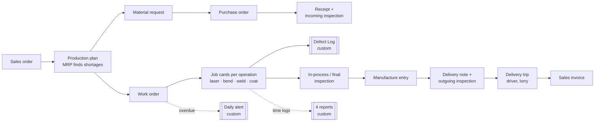

| Area | Standard ERPNext (configured) | Custom code in `ombak_mfg` |
|---|---|---|
| Masters | Company, fiscal years, warehouses (raw, WIP, finished, rejected), 10 raw materials, 5 products, BOMs with routing, 4 workstations with labour + machine cost, QI templates, customers, suppliers, driver, lorry, holiday list | Idempotent setup script that builds all of it |
| Flow | Sales order → production plan (MRP) → material request → PO → receipt → work order → job cards → manufacture → delivery note → delivery trip → invoice | Script that generates one month of realistic data, relative to today |
| Shop floor | Job cards, capacity planning | **Defect Log** + **Defect Reason** doctypes |
| Management | | **4 Script Reports**, **daily overdue alert**, **Ombak Factory** workspace with 3 number cards |

## Run it

Needs Docker Desktop (about 8 GB disk, 4 GB RAM for the containers).

```bash
cd ERP
docker compose up -d --build          # first run builds the image and creates the site (~2-5 min)
docker compose exec backend bench --site localhost execute ombak_mfg.setup.demo.run         # ~1 min
docker compose exec backend bench --site localhost execute ombak_mfg.setup.check_demo.check # prints PASS/FAIL per check
docker compose exec portal python manage.py seed_operators                                  # terminal sign-ins for the 4 operators
```

Open **http://localhost:8080** for ERPNext and **http://localhost:8081** for the shop-floor
terminal (use `localhost`, not `127.0.0.1`: the site is named after the host, and live
updates only work there).

| Login (local demo only) | Password | Role |
|---|---|---|
| `Administrator` | `admin` | everything |
| `lim.weijie@ombakmetal.example` | `Ombak@2026` | production manager (gets the overdue alert) |
| terminal: `ahmad`, `meiling`, `rajesh`, `nurul` | `Operator@2026` | operators (see below) |

Both ports are bound to `127.0.0.1`, so nothing is reachable from your network.

- **Tests:** `bash ERP/scripts/test.sh` (32 ERPNext integration tests on a separate `test.localhost` site) and `bash ERP/scripts/test-portal.sh` (63 Django tests, including live contract tests against a separate `contract.localhost` ERPNext site). The demo data is never touched.
- **Start over:** demo dates are relative to the day you generate them. `docker compose down -v`, then run the three commands above again.
- **Trigger the alert now** instead of waiting for the daily job: `docker compose exec backend bench --site localhost execute ombak_mfg.tasks.notify_overdue_work_orders`.
- **After editing app code:** `docker compose restart backend` (nginx and the websocket follow it); after editing terminal code, `docker compose restart portal`. To edit DocTypes in the UI, first run `bench --site localhost set-config developer_mode 1` so changes are written back into the app.

## The custom parts

| Piece | Where | Rule |
|---|---|---|
| Defect Log | `ombak_mfg/ombak_mfg/doctype/defect_log/` | Links a **submitted** job card; work order, operation, workstation and item are filled from it and read-only. The submitted defective qty on one job card can't exceed its completed qty. Cancelled logs free their qty. |
| Work Order On-Time Rate | `…/report/work_order_on_time_rate/` | Completed work orders in the range. **On time** = finished on or before the planned end **date** (finishing later the same day still counts). Shows on-time % and average days late. |
| Workstation Load | `…/report/workstation_load/` | Minutes ERPNext's capacity plan scheduled on each workstation in the chosen week ÷ available minutes (working hours × 6 days). ≥ 90 % is flagged as a bottleneck. Capacity planning never books a station past 100 %; it pushes work into later weeks. |
| Operation Time Variance | `…/report/operation_time_variance/` | Each completed job card: standard minutes (BOM time × qty) vs actual logged minutes, variance in minutes and %. |
| Defect Pareto | `…/report/defect_pareto/` | Submitted defect logs by reason, largest first, with % and cumulative %. |
| Overdue alert | `ombak_mfg/tasks.py` (daily) | One bell notification per Manufacturing Manager per day: "Overdue work orders: N". Clicking it opens the work order list filtered to those orders. Bell only, no email (the demo has no mail server). |
| Demo data | `ombak_mfg/setup/masters.py`, `demo.py`, `check_demo.py` | 19 orders: 9 finished on time, 3 late (each with a rejected in-process inspection and rework), 3 open and overdue, 4 planned for the coming days. |

## Shop-floor terminal (Django)

ERPNext's Job Card form is built for planners, not for an operator wearing gloves. The
terminal (`ERP/portal/`, Django 6.1) is the page at each station: pick the workstation,
see its open job cards, **Start / Pause / Resume / Complete**, and log defects. ERPNext
stays the only place the data lives; Django stores just the operator sign-ins.

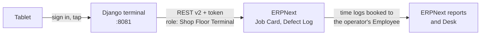

| Operator (`Operator@2026`) | Home station |
|---|---|
| `ahmad` | Laser Cutting |
| `meiling` | CNC Press Brake |
| `rajesh` | Welding Bay |
| `nurul` | Powder Coating |

Any operator can work any station (pick it in the header); each time log is booked to the
operator's own ERPNext Employee, so Desk shows who did the work.

**How the queue works**
- All open job cards for the station, each with a status (**Running**, **Paused**,
  **Ready**, or **Waiting** for an earlier operation) and a timing label (**Overdue**:
  planned end passed, **Today**: planned to start by end of today, **Later**).
- Order: running, paused, then overdue, today, later. Up to 50 cards per station.
- **Complete** books the full remaining quantity in one step; bad parts go in as up to
  three defect lines (reason + qty). A paused card is resumed and completed at the same
  instant, because ERPNext won't submit a card that is on hold (this leaves a zero-minute
  time log in Desk).

**Design decisions worth asking about**
- **Times are sent as Kuala Lumpur wall-clock time.** ERPNext stores naive local times;
  sending UTC shifted every log by 8 hours (found and fixed in the contract tests).
- **ERPNext's own Job Card methods** (`start_timer`, `pause_job`, `resume_job`,
  `complete_job_card`) do the work, so ERPNext's sequence and overlap rules still apply. The
  terminal adds the checks ERPNext doesn't make: no second Start on a running or paused
  card, Resume only when paused, Complete only after Start.
- **Least privilege:** the API user has one role, *Shop Floor Terminal*: Job Card
  read/write/submit, Workstation and Employee read, Defect Log create/submit, Defect Reason
  read, and Work Order read/write/submit (completing a job card updates its submitted work
  order, and Frappe checks *submit* for that). It cannot create or cancel work orders or
  read sales, accounts, BOMs or stock (tests prove each refusal).
- **Safe by default:** every action is a POST with CSRF; job card names must match
  `PO-JOB` + ASCII digits before any ERPNext call; ERPNext's HTML error text is stripped;
  a strict Content-Security-Policy (no inline script or style anywhere); 64 px buttons for
  gloved hands; Lighthouse mobile 100/100/100.
- **Errors say what happened:** ERPNext refusals show ERPNext's message; a dropped
  connection during a save says to check ERPNext before trying again.

**Code layout** (`ERP/portal/terminal/`)

| Module | Job |
|---|---|
| `erpnext.py` | the only code that talks HTTP: REST v2 client, error mapping |
| `queue.py` | pure logic: status, timing labels, ordering, elapsed time |
| `views.py` | queue, start/pause/resume, complete (+ defect lines) |
| `forms.py` | the complete form's defect lines |
| `models.py` | `Operator`: Django user ↔ ERPNext Employee + home station |
| `management/commands/seed_operators.py` | demo sign-ins, linked by employee name |
| `templates/`, `static/` | one tokenised stylesheet, a small script (timer, busy buttons, auto-refresh) |
| `tests/` | unit tests with a fake ERPNext, live contract tests (`api-contract.md` in `.specship/`) |

Settings come from environment variables with local-demo defaults (`ERP/docker-compose.yml`):
`PORTAL_SECRET_KEY`, `SHOPFLOOR_API_KEY`, `SHOPFLOOR_API_SECRET`, `OPERATOR_PASSWORD`. Put
real values in `ERP/.env` for anything beyond a laptop demo.

**Limits:** full quantity only (no partial completion); defects only at completion; no
barcode scanning, offline mode or PIN quick-switch; the dev bind mount serves static files
with auto-refresh.

| Tablet | Phone |
|---|---|
| 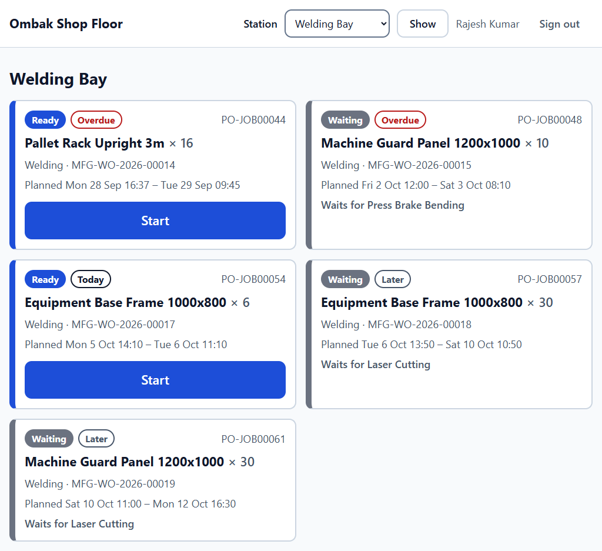 | 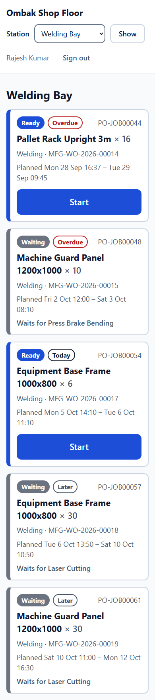 |

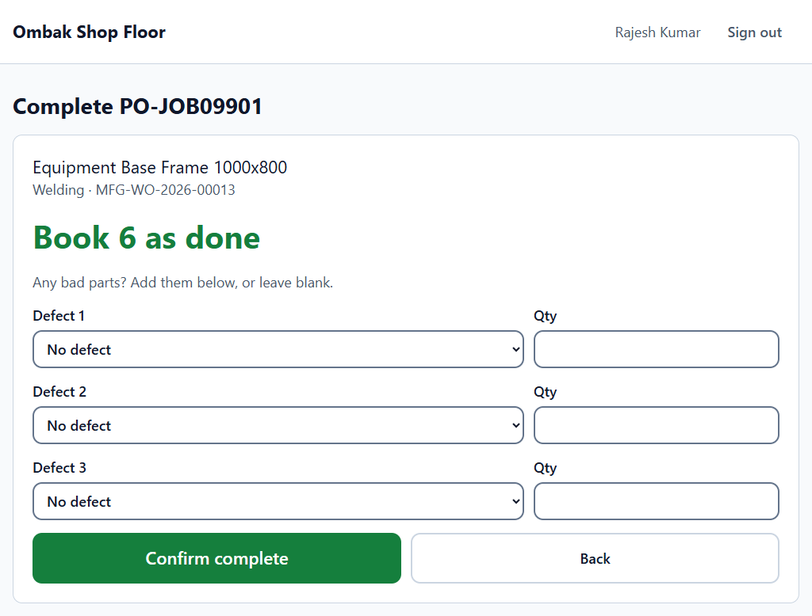

## Demo video click path

1. **Ombak Factory** workspace: the 3 number cards and the report shortcuts.
2. **Sales Order** → open one from early in the month → **Connections**: production plan, work order, delivery note, invoice.
3. **Production Plan** for an order of *Pallet Rack Upright 3m*: MRP found no GI 2.0 mm sheet in stock and raised a **material request** → **purchase order** → **purchase receipt** with an **incoming inspection**.
4. **Work Order** → its 4 **job cards**: time logs per operation, all in sequence.
5. **Defect Log** → new → pick a job card → try a qty larger than was produced → the error.
6. **Reports**: On-Time Rate (find a late order and its rejected inspection), Workstation Load for next week (Welding Bay is the busiest), Operation Time Variance, Defect Pareto.
7. **Delivery Trip**: driver, lorry, stops.
8. Log in as the production manager → **bell** → overdue alert → filtered list.
9. **Terminal** (http://localhost:8081, `rajesh`): Laser Cutting → **Start** a Ready card → timer → **Pause** → **Resume** → **Complete** with one defect line → the card leaves the queue.
10. Back in ERPNext Desk: that **Job Card** is Completed with Rajesh Kumar's time logs, and the **Defect Log** is there; the next operation's card is now Ready on its station.

## Design decisions and limits

- **Configure first, code second.** Everything ERPNext already does (MRP, capacity planning, inspections, delivery trips) is configuration; custom code only fills gaps.
- **No transfer to the WIP warehouse.** Work orders consume material straight from the raw-material store at the manufacture entry (`skip_transfer`). This is simpler for a small job shop; the WIP and Rejected warehouses exist but stay empty.
- **Defect logs don't move stock.** They are a quality record. Scrapping or reworking parts would be a separate stock entry.
- **Single company, MYR only**, default chart of accounts, no HR or payroll.
- **Local demo only:** default passwords, no HTTPS. `docker-compose.yml` is adapted from frappe_docker's `pwd.yml`. Two changes make live updates work locally: the site is named `localhost`, and the websocket container shares the backend's network.

## Built with

ERPNext / Frappe v16, MariaDB, Redis, Docker. Python for the app, SQL (via Frappe's query
builder, always with bound parameters) for the reports. Django 6.1, gunicorn and WhiteNoise
for the shop-floor terminal, with plain CSS (design tokens) and a few lines of JavaScript. Built with AI assistance (Claude) using a
spec → tests → build → independent review workflow; the specs and test plans are in `.specship/`.

---

## 中文说明

**Ombak Metal Works Sdn Bhd** 是一家**虚构**的柔佛州钣金加工厂（按订单生产）。这个仓库用 **ERPNext v16**
实施它的 ERP，写了一个自定义 Frappe 应用 `ombak_mfg`，补上 ERPNext 原本没有、但生产主管需要的功能，
另外用 **Django** 写了一个车间平板报工页，只通过 REST API 读写 ERPNext。

这是三部分中的第一部分：**ERP**（`ERP/`：ERPNext + `ombak_mfg` + Django 平板页）→ 第二部分 **CRM**（Django，`CRM/`）
→ 第三部分 **系统串接**（CRM 成交 → ERP 自动建销售订单）。公司、客户、供应商和人名全部是虚构的。

### 内容

- **标准 ERPNext 设定**：仓库（原料、在制、成品、不良品），10 种原料，5 种成品，带工序路线的 BOM（激光切割 → 折弯 → 焊接 → 喷涂），4 个工作站（分人工和机器费率），质检模板，客户、供应商、司机、货车。
- **完整流程**：销售订单 → 生产计划（MRP 自动算缺料）→ 请购 → 采购 → 收货 + 进料检验 → 工单 → 各工序的工序卡报工 → 生产入库 → 出货 + 出货检验 → 派车 → 开票。
- **自定义代码**：
  - 不良登记（Defect Log，带原因代码，数量不能超过已完工数量）
  - 4 张报表：工单准时率、工作站周负荷、实际与标准工时差异、不良 Pareto
  - 每日逾期工单提醒（铃铛通知）
  - 「Ombak Factory」工作台
- **车间平板页（Django）**：操作员选工作站 → 看到这个站所有未完成的工序卡（标出逾期 / 今天 / 之后）→ 开始 / 暂停 / 继续 / 完成，并登记不良。数据全部写回 ERPNext，工时记在操作员自己的员工名下。
- **演示数据**：一键生成一个月的数据，日期以生成当天为准。

### 启动

```bash
cd ERP
docker compose up -d --build
docker compose exec backend bench --site localhost execute ombak_mfg.setup.demo.run
docker compose exec backend bench --site localhost execute ombak_mfg.setup.check_demo.check
docker compose exec portal python manage.py seed_operators
```

ERPNext 打开 **http://localhost:8080**，平板页打开 **http://localhost:8081**（请用 `localhost`，不要用 `127.0.0.1`）。本地演示账号：

| 账号 | 密码 | 角色 |
|---|---|---|
| `Administrator` | `admin` | 系统管理员 |
| `lim.weijie@ombakmetal.example` | `Ombak@2026` | 生产主管（会收到逾期提醒） |
| 平板页：`ahmad`、`meiling`、`rajesh`、`nurul` | `Operator@2026` | 操作员（默认工作站：激光切割、折弯、焊接、喷涂） |

- **测试**：`bash ERP/scripts/test.sh`（ERPNext 32 个测试）和 `bash ERP/scripts/test-portal.sh`（Django 63 个测试，其中包括对真实 ERPNext 测试站点的合约测试），都不会动到演示数据。
- **重来**：`docker compose down -v`，然后重新执行上面四条命令。

### 报表规则

- **准时率**：按日期比较，实际完工日期不晚于计划完工日期就算准时。同一天晚一点完成也算准时。
- **工作站负荷**：取 ERPNext 产能排程排进该周的分钟数，除以可用分钟数（每天工作时数 × 6 天）。负荷 ≥ 90% 标为瓶颈。产能排程本身不会排超过 100%，多出来的工作会顺延到之后几周。
- **工时差异**：每张已完成的工序卡，标准工时（BOM 工时 × 数量）对比实际报工工时。
- **不良 Pareto**：按原因汇总已提交的不良登记，从多到少排列，并显示累计百分比。

### 平板页的设计重点

- **时间用吉隆坡当地时间发送**：ERPNext 存的是不带时区的本地时间，发 UTC 会让所有工时差 8 小时（合约测试抓到后修正）。
- **直接调用 ERPNext 自己的工序卡方法**，所以 ERPNext 原有的工序顺序和工时重叠检查都还在；平板页再补上 ERPNext 没做的检查（不能重复开始、只有暂停中才能继续、没开始不能完成）。
- **最小权限**：对接用户只有一个专用角色「Shop Floor Terminal」，读不了销售、会计、BOM、库存，也不能新建或取消工单（测试逐项验证）。完成工序卡时 ERPNext 要更新已提交的工单，所以保留了工单的「提交」权限。
- **安全**：所有操作都是带 CSRF 的 POST；工序卡名称只接受 `PO-JOB` 加 ASCII 数字；ERPNext 错误里的 HTML 会被去掉；严格的 CSP；按钮 64 px，戴手套也能按；Lighthouse 手机模式 100/100/100。
- **限制**：完成时只报剩余全部数量；不良只能在完成时登记，最多 3 行；没有扫码、离线和快速切换操作员。

### 取舍与限制

- **能用设定解决的就不写代码**：MRP、产能排程、质检、派车都是标准功能。
- **工单不经在制仓**：生产入库时直接从原料仓扣料。
- **不良登记只是质量记录**，不影响库存。
- **只有一家公司、只用马币**，没有人事和薪资模块。
- **仅供本地演示**：使用默认密码，没有 HTTPS。

这个项目是在 AI（Claude）辅助下完成的，流程是：需求规格 → 先写测试 → 实现 → 独立验证。规格和测试计划放在 `.specship/`。

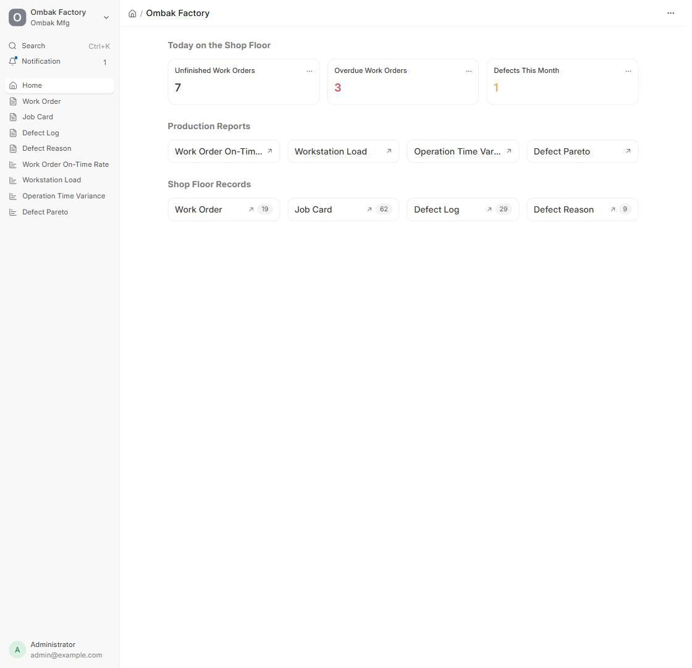
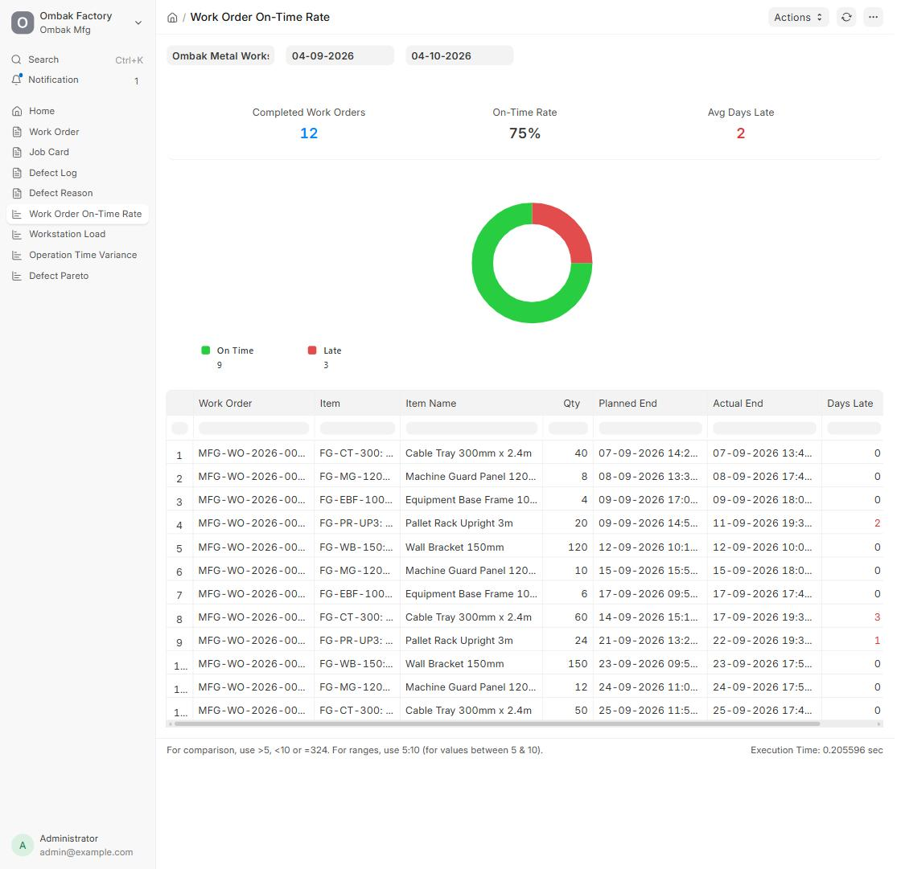
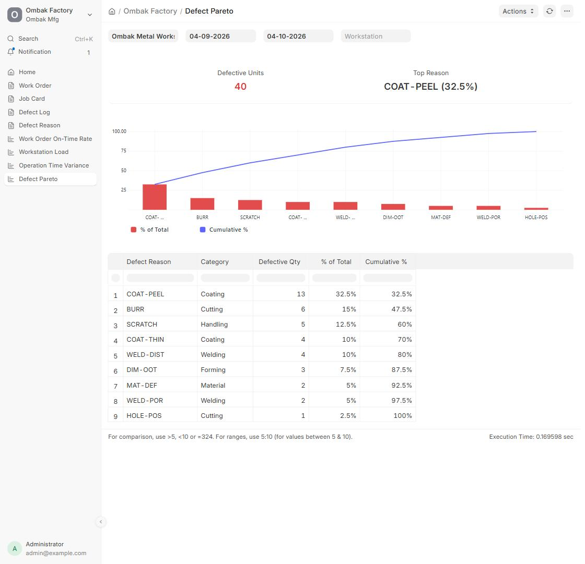
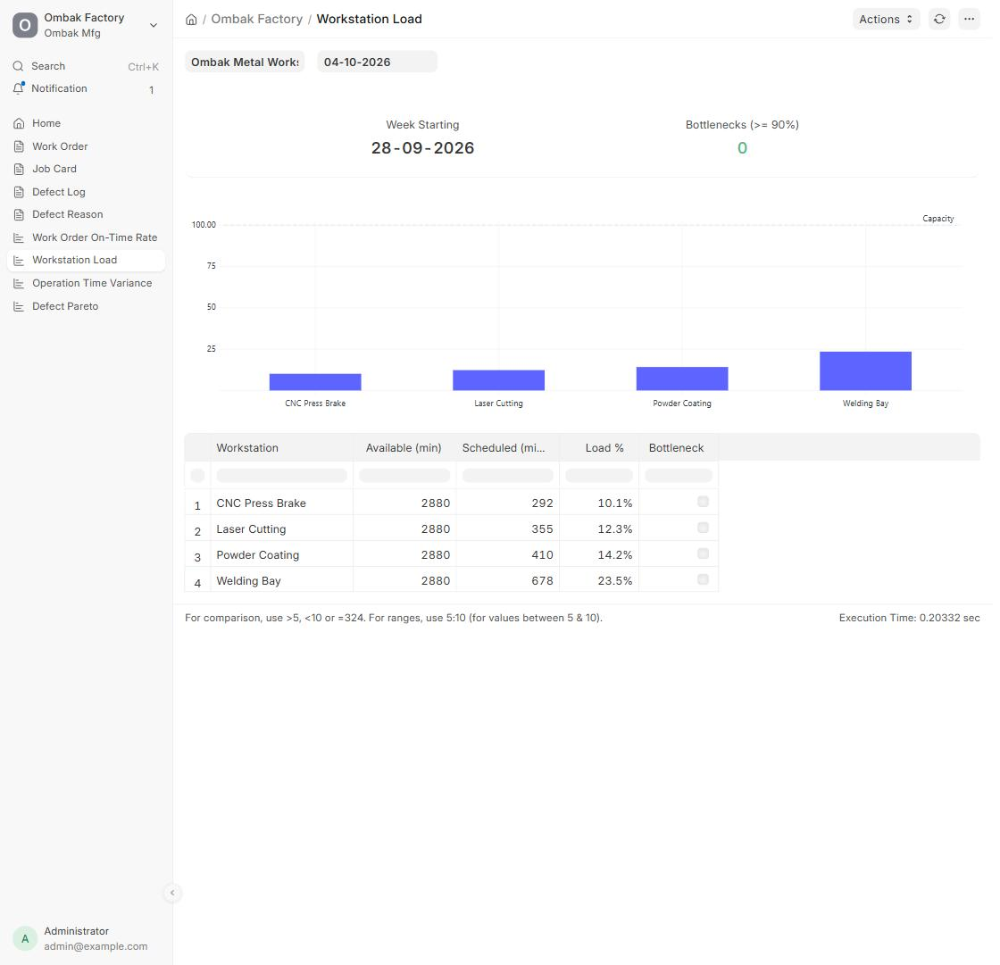
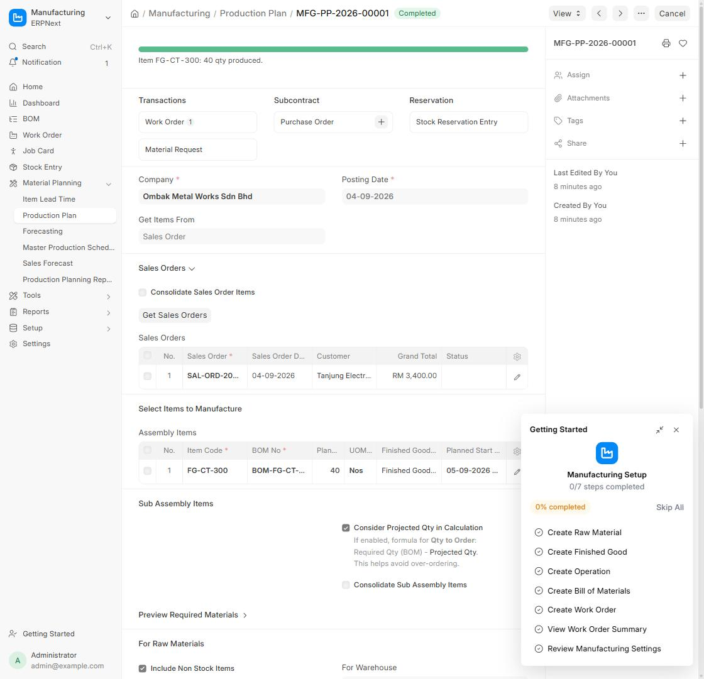
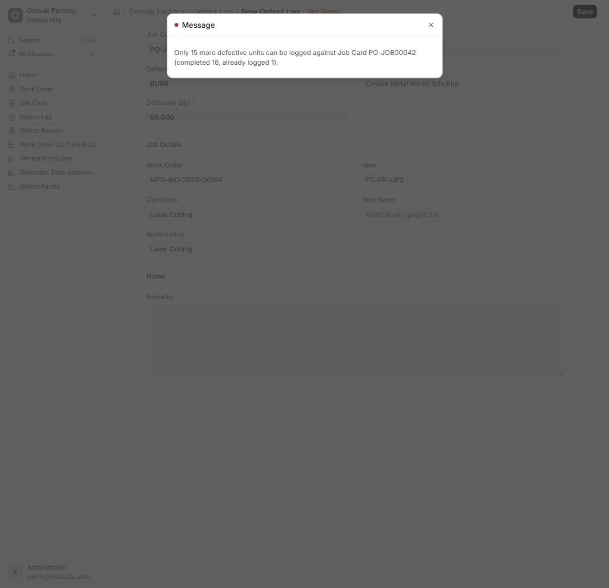
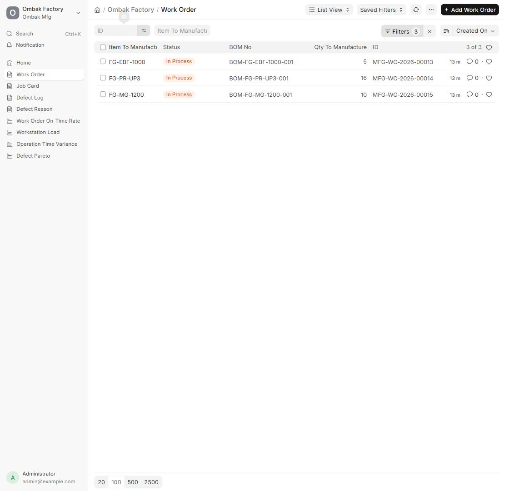
