# ERPNext + Django CRM: factory ERP, shop-floor terminal and sales CRM demo

[中文说明](#中文说明)

The demo company, Ombak Metal Works Sdn Bhd, is a **fictional** make-to-order sheet-metal
fabricator in Johor.
This repo implements its ERP on **ERPNext v16**, adds a custom Frappe app, `ombak_mfg`, for
the things a production manager needs that ERPNext doesn't ship with, and a **Django
shop-floor terminal** that operators use on a tablet, talking to ERPNext only through its
REST API. The sales team works in a separate **Django sales CRM**, and a won deal becomes an
ERPNext sales order.

Part 1 of 3: **ERP** (`ERP/`: ERPNext + `ombak_mfg` + the Django terminal) → part 2
**CRM** (Django + PostgreSQL, `CRM/`, [below](#sales-crm-django)) → part 3 **integration**
(CRM deal won → ERP sales order). All company, customer, supplier and person names are
invented.

## What it shows

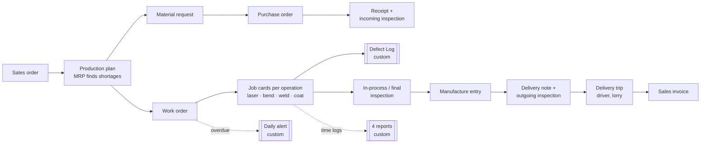

| Area | Standard ERPNext (configured) | Custom code in `ombak_mfg` |
|---|---|---|
| Masters | Company, fiscal years, warehouses (raw, WIP, finished, rejected), 10 raw materials, 5 products, BOMs with routing, 4 workstations with labour + machine cost, QI templates, customers, suppliers, driver, lorry, holiday list | Idempotent setup script that builds all of it |
| Flow | Sales order → production plan (MRP) → material request → PO → receipt → work order → job cards → manufacture → delivery note → delivery trip → invoice | Script that generates one month of realistic data, relative to today |
| Shop floor | Job cards, capacity planning | **Defect Log** + **Defect Reason** doctypes |
| Management | | **4 Script Reports**, **daily overdue alert**, **Ombak Factory** workspace with 3 number cards |

## Run it

Needs Docker Desktop (about 8 GB disk, 4 GB RAM for the containers).

```bash
cd ERP
docker compose up -d --build          # first run builds the image and creates the site (~2-5 min)
docker compose exec backend bench --site localhost execute ombak_mfg.setup.demo.run         # ~1 min
docker compose exec backend bench --site localhost execute ombak_mfg.setup.check_demo.check # prints PASS/FAIL per check
docker compose exec portal python manage.py seed_operators                                  # terminal sign-ins for the 4 operators
```

Open **http://localhost:8080** for ERPNext and **http://localhost:8081** for the shop-floor
terminal (use `localhost`, not `127.0.0.1`: the site is named after the host, and live
updates only work there).

| Login (local demo only) | Password | Role |
|---|---|---|
| `Administrator` | `admin` | everything |
| `lim.weijie@ombakmetal.example` | `Ombak@2026` | production manager (gets the overdue alert) |
| terminal: `ahmad`, `meiling`, `rajesh`, `nurul` | `Operator@2026` | operators (see below) |

Both ports are bound to `127.0.0.1`, so nothing is reachable from your network.

- **Tests:** `bash ERP/scripts/test.sh` (50 ERPNext integration tests on a separate `test.localhost` site) and `bash ERP/scripts/test-portal.sh` (63 Django tests, including live contract tests against a separate `contract.localhost` ERPNext site). The demo data is never touched.
- **Manual test checklist:** [`docs/test-manual.html`](docs/test-manual.html), in English and Chinese (opens in English; switch with the EN / 中文 button at the top). Download it and open it in a browser. It lists 45 page-by-page checks across ERPNext, the terminal, the CRM and the CRM → ERPNext link: the URL to open (one click), what to do and what you should see. You can mark each check passed or failed, note what went wrong, and copy a summary of the results. Commands have copy buttons. The marks stay in your browser only.
- **Start over:** demo dates are relative to the day you generate them. `docker compose down -v`, then run the three commands above again.
- **Trigger the alert now** instead of waiting for the daily job: `docker compose exec backend bench --site localhost execute ombak_mfg.tasks.notify_overdue_work_orders`.
- **After editing app code:** `docker compose restart backend` (nginx and the websocket follow it); after editing terminal code, `docker compose restart portal`. To edit DocTypes in the UI, first run `bench --site localhost set-config developer_mode 1` so changes are written back into the app.

## The custom parts

| Piece | Where | Rule |
|---|---|---|
| Defect Log | `ombak_mfg/ombak_mfg/doctype/defect_log/` | Links a **submitted** job card; work order, operation, workstation and item are filled from it and read-only. The submitted defective qty on one job card can't exceed its completed qty. Cancelled logs free their qty. |
| Work Order On-Time Rate | `…/report/work_order_on_time_rate/` | Completed work orders in the range. **On time** = finished on or before the planned end **date** (finishing later the same day still counts). Shows on-time % and average days late. |
| Workstation Load | `…/report/workstation_load/` | Minutes ERPNext's capacity plan scheduled on each workstation in the chosen week ÷ available minutes (working hours × 6 days). ≥ 90 % is flagged as a bottleneck. Capacity planning never books a station past 100 %; it pushes work into later weeks. |
| Operation Time Variance | `…/report/operation_time_variance/` | Each completed job card: standard minutes (BOM time × qty) vs actual logged minutes, variance in minutes and %. |
| Defect Pareto | `…/report/defect_pareto/` | Submitted defect logs by reason, largest first, with % and cumulative %. |
| Overdue alert | `ombak_mfg/tasks.py` (daily) | One bell notification per Manufacturing Manager per day: "Overdue work orders: N". Clicking it opens the work order list filtered to those orders. Bell only, no email (the demo has no mail server). |
| Demo data | `ombak_mfg/setup/masters.py`, `demo.py`, `check_demo.py` | 19 orders: 9 finished on time, 3 late (each with a rejected in-process inspection and rework), 3 open and overdue, 4 planned for the coming days. |

| Ombak Factory workspace | Overdue alert |
|---|---|
|  |  |

| Production plan (MRP) | Defect log over the completed qty |
|---|---|
|  |  |

| Work Order On-Time Rate | Workstation Load |
|---|---|
|  |  |

Defect Pareto:


## Shop-floor terminal (Django)

ERPNext's Job Card form is built for planners, not for an operator wearing gloves. The
terminal (`ERP/portal/`, Django 6.1) is the page at each station: pick the workstation,
see its open job cards, **Start / Pause / Resume / Complete**, and log defects. ERPNext
stays the only place the data lives; Django stores just the operator sign-ins.

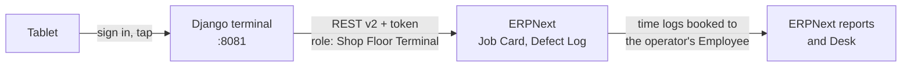

| Operator (`Operator@2026`) | Home station |
|---|---|
| `ahmad` | Laser Cutting |
| `meiling` | CNC Press Brake |
| `rajesh` | Welding Bay |
| `nurul` | Powder Coating |

Any operator can work any station (pick it in the header); each time log is booked to the
operator's own ERPNext Employee, so Desk shows who did the work.

**How the queue works**
- All open job cards for the station, each with a status (**Running**, **Paused**,
  **Ready**, or **Waiting** for an earlier operation) and a timing label (**Overdue**:
  planned end passed, **Today**: planned to start by end of today, **Later**).
- Order: running, paused, then overdue, today, later. Up to 50 cards per station.
- **Complete** books the full remaining quantity in one step; bad parts go in as up to
  three defect lines (reason + qty). A paused card is resumed and completed at the same
  instant, because ERPNext won't submit a card that is on hold (this leaves a zero-minute
  time log in Desk).

**Design decisions worth asking about**
- **Times are sent as Kuala Lumpur wall-clock time.** ERPNext stores naive local times;
  sending UTC shifted every log by 8 hours (found and fixed in the contract tests).
- **ERPNext's own Job Card methods** (`start_timer`, `pause_job`, `resume_job`,
  `complete_job_card`) do the work, so ERPNext's sequence and overlap rules still apply. The
  terminal adds the checks ERPNext doesn't make: no second Start on a running or paused
  card, Resume only when paused, Complete only after Start.
- **Least privilege:** the API user has one role, *Shop Floor Terminal*: Job Card
  read/write/submit, Workstation and Employee read, Defect Log create/submit, Defect Reason
  read, and Work Order read/write/submit (completing a job card updates its submitted work
  order, and Frappe checks *submit* for that). It cannot create or cancel work orders or
  read sales, accounts, BOMs or stock (tests prove each refusal).
- **Safe by default:** every action is a POST with CSRF; job card names must match
  `PO-JOB` + ASCII digits before any ERPNext call; ERPNext's HTML error text is stripped;
  a strict Content-Security-Policy (no inline script or style anywhere); 64 px buttons for
  gloved hands; Lighthouse mobile 100/100/100.
- **Errors say what happened:** ERPNext refusals show ERPNext's message; a dropped
  connection during a save says to check ERPNext before trying again.

**Code layout** (`ERP/portal/terminal/`)

| Module | Job |
|---|---|
| `erpnext.py` | the only code that talks HTTP: REST v2 client, error mapping |
| `queue.py` | pure logic: status, timing labels, ordering, elapsed time |
| `views.py` | queue, start/pause/resume, complete (+ defect lines) |
| `forms.py` | the complete form's defect lines |
| `models.py` | `Operator`: Django user ↔ ERPNext Employee + home station |
| `management/commands/seed_operators.py` | demo sign-ins, linked by employee name |
| `templates/`, `static/` | one tokenised stylesheet, a small script (timer, busy buttons, auto-refresh) |
| `tests/` | unit tests with a fake ERPNext, live contract tests (`api-contract.md` in `.specship/`) |

Settings come from environment variables with local-demo defaults (`ERP/docker-compose.yml`):
`PORTAL_SECRET_KEY`, `SHOPFLOOR_API_KEY`, `SHOPFLOOR_API_SECRET`, `OPERATOR_PASSWORD`. Put
real values in `ERP/.env` for anything beyond a laptop demo.

**Limits:** full quantity only (no partial completion); defects only at completion; no
barcode scanning, offline mode or PIN quick-switch; the dev bind mount serves static files
with auto-refresh.

| Tablet | Phone |
|---|---|
|  |  |


## Sales CRM (Django)

The sales team's own system (`CRM/`, Django 6.1 on PostgreSQL 17), a separate app from the
ERP. Web enquiries become leads that go to the rep for the customer's region. Leads
become deals that move through the factory's stages. Quotes come from the price list, and
big discounts need the sales manager. Every deal ends won, or lost with a reason. The
product codes and prices are the ERPNext items, and a won deal becomes an ERPNext sales
order ([part 3](#crm--erpnext-sales-orders-part-3)).

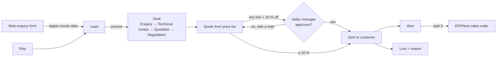

```bash
cd CRM
docker compose up -d --build                       # PostgreSQL + Django on http://localhost:8082
docker compose exec web python manage.py seed_demo  # team, products, 16 accounts, ~50 deals over 5 quarters
bash scripts/test.sh                                # 331 tests on PostgreSQL (17 live ERPNext tests skip here)
```

| Login (local demo only, `Sales@2026`) | Role | Region |
|---|---|---|
| `hafiz` | sales manager: sees everything, approves discounts, reassigns, `/admin/` | |
| `aisyah` | rep | North (Perlis, Kedah, Penang, Perak, Kelantan, Terengganu) |
| `kumar`, `jason` | reps | Central (Selangor, KL, Putrajaya, N. Sembilan, Pahang, East Malaysia) |
| `siti` | rep | South (Johor, Melaka) |
| `weiling` | rep | Singapore |

The public enquiry form is at **http://localhost:8082/enquiry/** (no sign-in).

**The rules it enforces**
- **Lead routing:** a rep who types a lead owns it. A web enquiry goes to the active rep
  in its region with the fewest open leads (Central has two reps, so they take turns). If
  the region has no active rep, the lead is unassigned and appears on the manager's My day.
- **Stages:** Enquiry 10 %, Technical review / sampling 25 %, Quotation 50 %, Negotiation
  75 %. A deal can't enter Quotation or Negotiation without a sent quote, can't be won
  without one, and can't be lost without a reason from the admin-editable list. Every
  move is in the deal's history (who, when).
- **Quotes:** the unit price is the list price and can't be typed; the only lever is a
  per-line discount. Any line above 10 % sends the quote to the manager, who approves or
  rejects with a note.
  - The manager approves exactly the lines on screen. If the quote changed after the page
    was opened, Approve is refused with "This quote changed since you opened it".
  - Only approved quotes can be printed or sent, and approved or sent quotes are locked.
  - "Revise" makes a new draft. The old quote stays sent until the revision goes out.
- **Editing:**
  - The owner or the manager edits an open deal (title, contact, expected close, value).
    The value locks once a quote is sent, because the quote sets it.
  - Open leads can be corrected. A new state moves the lead to the new region but keeps
    its owner.
  - Accounts and contacts are shared, so anyone can edit them.
  - Won, lost, converted and disqualified records are read-only.
  - The manager reassigns a deal to another rep, and its open activities move with it.
- **Reps see only their own** leads, deals, quotes and activities. Another rep's record
  answers 404, not 403, so ids don't leak. Accounts are shared.
- **Reports** for any quarter:
  - open pipeline by stage (value and weighted value);
  - win rate per rep (won ÷ (won + lost), by count);
  - forecast (won + weighted pipeline closing in the quarter, plus a best case);
  - lost reasons.
- **My day:**
  - Everyone sees their overdue and today's activities, deals with no next step, deals
    untouched for 14 days, and new leads.
  - The manager's deal panels cover the whole team and name each owner. The manager also
    sees quotes waiting for approval and unassigned leads.
  - "Today" is a Kuala Lumpur date, also at 7 a.m. when UTC is still yesterday.

**Design decisions worth asking about**
- **Rules live in one place.** `rules.py` holds the money, discount and stage rules as
  plain functions.
  - The workflow methods on the models (`Quote.submit/approve/send/revise`,
    `Opportunity.move_to/mark_won/mark_lost/edit/reassign`, `Lead.convert/edit`) take row
    locks and re-check the state under the lock. A double click can't convert a lead or
    win a deal twice, and a line added during Submit can't slip past approval.
  - The database backs them up with check constraints: discount 0-100, qty > 0, an
    activity has exactly one parent.
- **Money is `Decimal`**, and each line is rounded half-up to 2 dp before summing (85.00 × 3
  less 7.5 % = 235.88).
- **Reports run a fixed number of aggregate queries** (≤ 15 for the whole page), however
  many deals there are. A test counts them.
- **Board without a JS framework:** every card has a "Move to" select that works by
  keyboard and without JavaScript. Drag and drop just submits that same form, so both go
  through the same server rules.
- **Safe by default:**
  - CSRF on every POST, and a strict CSP (no inline script or style).
  - Sign-in lockout after 10 failures per username in 15 minutes. It covers `/login/`
    and `/admin/login/` alike, and a database row lock counts parallel attempts exactly.
  - The manager can manage reps in `/admin/` but can't grant anyone admin rights.
  - The enquiry form has a honeypot and a rate limit.
  - The CSV export neutralises spreadsheet formulas, because names typed into the public
    form end up in it.
- **Accessible:**
  - 44 px controls and visible focus.
  - Form errors sit next to their field, and focus jumps to the first one.
  - Labelled controls on the board, and server-rendered SVG bars in the reports.
  - Lighthouse 100/100/100 on My day, the board and a quote page.

**Code layout** (`CRM/sales/`)

| Module | Job |
|---|---|
| `models.py` | data model + workflow methods (row-locked) |
| `rules.py` | pure rules: money, approval limit, stage gates, next-activity indicator, win rate |
| `regions.py` | state → region table, round-robin owner pick |
| `access.py` | who sees what (every view gets records through it) |
| `ratelimit.py` | fixed-window counters for the sign-in lockout and the enquiry limit |
| `admin.py` | products, lost reasons, reps; the user admin that stops privilege escalation |
| `reports.py` | the four reports as aggregate queries |
| `views/` | My day, sign-in, leads, enquiry, accounts, activities, deals and board, quotes, reports |
| `management/commands/seed_demo.py` | idempotent demo data relative to today |
| `erpnext.py`, `erp.py` | the ERPNext link (part 3): REST client; mapping and the send flow |
| `tests/` | 331 tests covering every case in the 003 and 004 test plans under `.specship/completed/` |

Settings come from environment variables with local-demo defaults (`CRM/docker-compose.yml`):
`CRM_SECRET_KEY`, `CRM_DB_PASSWORD`, `CRM_DEMO_PASSWORD`. `CRM/scripts/ui-probe/` checks
three screen sizes, the focus after a form error, and Lighthouse.

**Locked out?** Ten wrong passwords lock a username for 15 minutes, and there is no unlock
button. To clear one user's lock:
`docker compose exec web python manage.py shell -c "from sales import ratelimit; ratelimit.clear('login', 'hafiz')"`.

**Limits:**
- MYR only, and quotes exclude SST (the ERPNext order adds it for Malaysian customers, part 3).
- One approval level.
- No email or calendar sync, attachments or custom fields.
- Closed deals can't be reopened.
- Edits and reassignments aren't kept in the deal history.
- Reps get no notification when a quote is approved or rejected, and expired quotes carry
  no marker.
- The enquiry limit keys on the client address, which is the Docker gateway for every
  local visitor, so five enquiries from anyone close the form for an hour.

| My day (manager) | Pipeline |
|---|---|
| 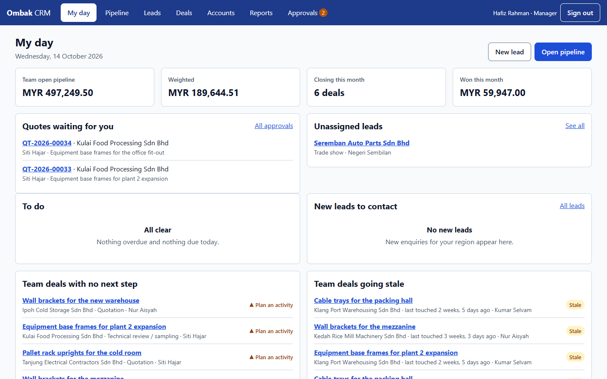 | 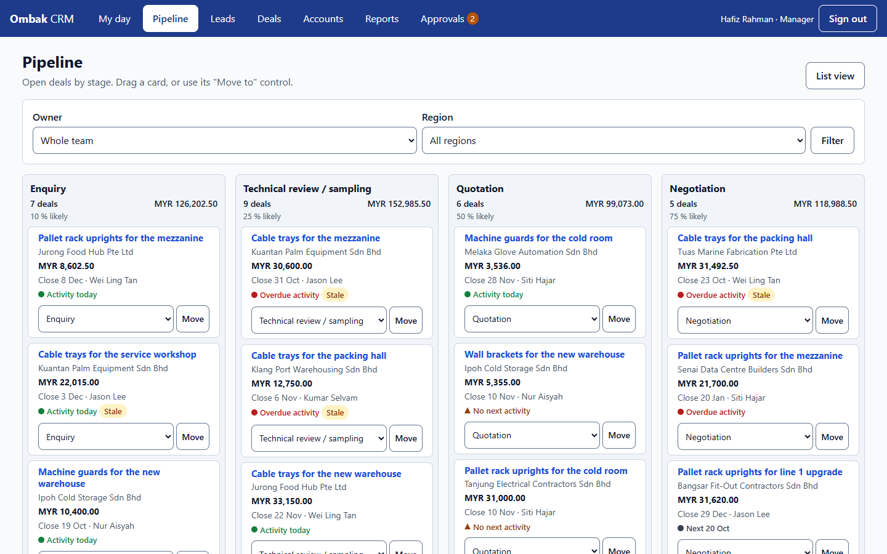 |

| Quote waiting for approval | Reports |
|---|---|
| 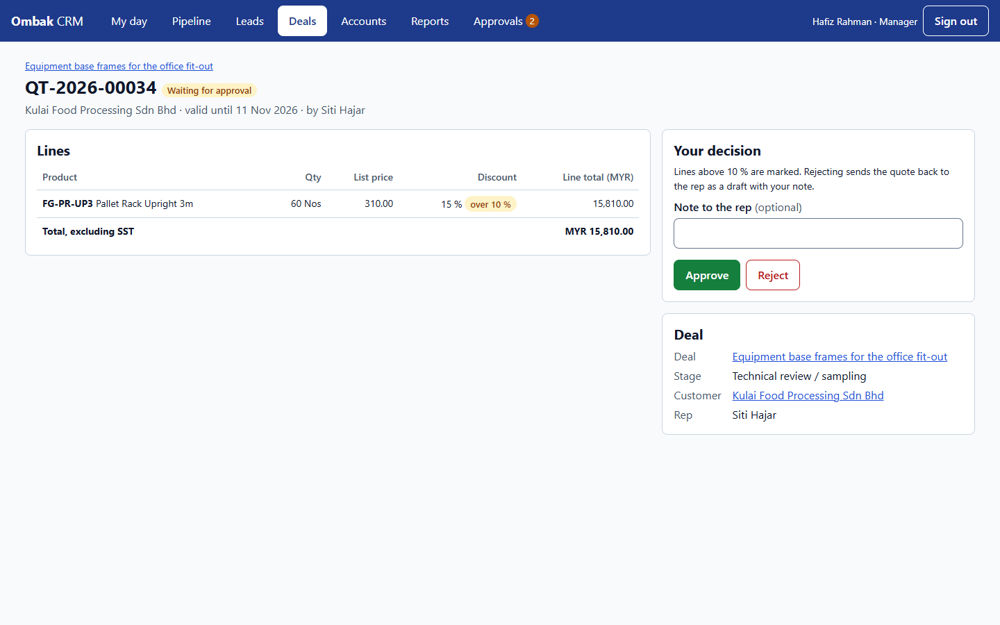 | 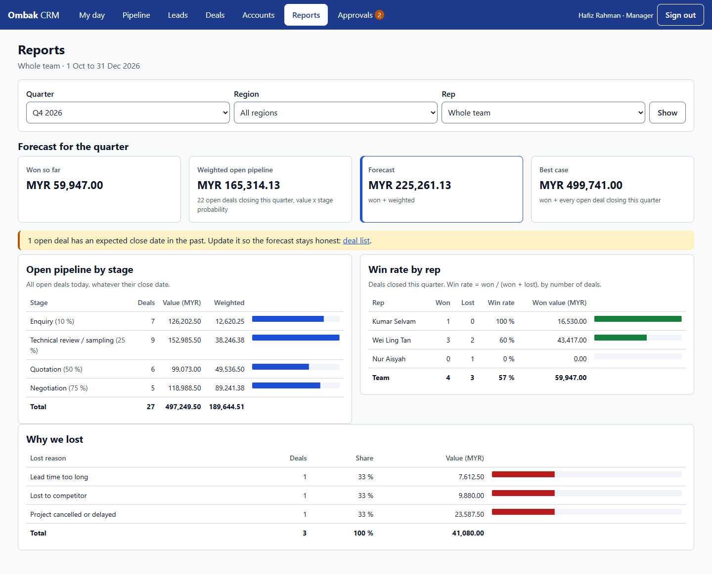 |

| Edit a deal | My day on a phone |
|---|---|
| 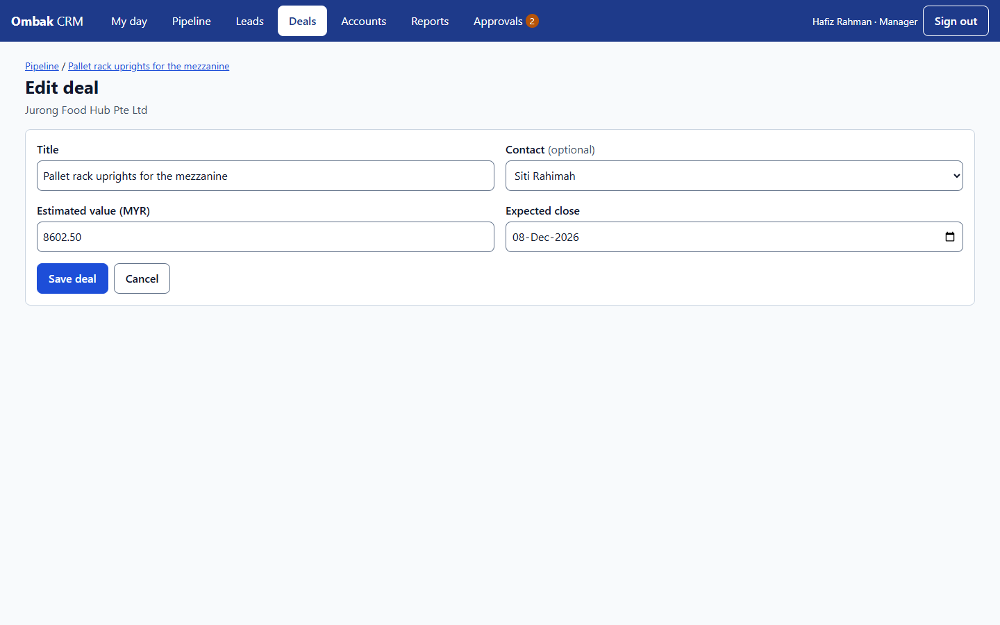 | 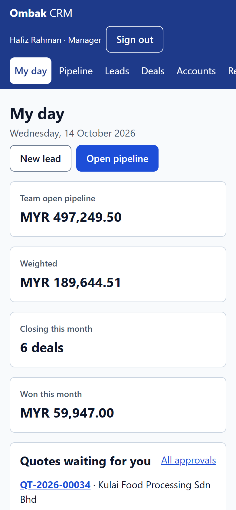 |

## CRM → ERPNext sales orders (part 3)

When a rep marks a deal **Won**, the CRM creates a **submitted sales order** in ERPNext in
the same request, so the production manager can plan from it straight away. The two systems
stay separate: the CRM talks to ERPNext only through its REST API, as the terminal does.

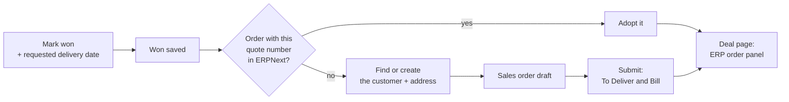

```bash
cd ERP && docker compose up -d          # start ERP first: it creates the erp_crm_link network
cd ../CRM
docker compose -f docker-compose.yml -f docker-compose.erp.yml up -d --build
bash scripts/test-erp.sh                # 17 live contract tests on the separate contract.localhost site
```

Without the override (`docker-compose.erp.yml`) the CRM runs on its own as in part 2, and won
deals say "ERP link not configured". An ERP site created before part 3 needs the CRM user
and keys once: `docker compose exec backend bench --site localhost set-config crm_api_key crm-demo-key`,
the same for `crm_api_secret` (`crm-demo-secret`), then
`docker compose exec backend bench --site localhost execute ombak_mfg.setup.masters.setup_masters`.

**What happens on Won**
- **Won is never lost.** Won is saved first; the order is sent right after (10 s limit). If
  ERPNext is down or refuses, the deal stays won and its **ERP order** panel shows the reason
  and a **Send again** form. Older won deals can be sent from the same panel.
- **No duplicate orders.** The quote number goes into the order's `crm_reference` field,
  which is unique in ERPNext. Every send looks it up first and adopts an order that already
  exists. A conditional "sending" claim stops two clicks from sending twice.
- **Customer:** found by exact name, or created (Company, group Commercial, territory
  Malaysia or Singapore from the account's state, SSM/UEN number as tax ID). A billing
  address is added when the account has an address and a city.
- **Exact total:** lines go at the quote's list price and the quote's discounts as one
  header discount, with rounding to whole ringgit off. The order's net total equals the quote
  to the sen. If ERPNext's total differs anyway, the panel says "Sent, total differs".
- **SST:** Malaysian customers' orders carry the template "Malaysia SST - OMW" (10 %, an
  assumption: some steel products are 5 % by tariff code; the rate lives only in that
  template). Singapore customers' orders carry no tax (assumed exported under K2).
- **Delivery date:** required at Won, default today + 14 days (Kuala Lumpur), from today to
  365 days ahead.
- **Who sends:** the deal owner or the manager. **My day** lists failed sends under "ERP
  orders not created" (the manager sees the team's).
- **Least privilege:** the ERPNext role *CRM Integration* creates sales orders, and reads,
  changes and submits only the ones it created (`if_owner`). It also reads and creates
  customers, creates and reads addresses, and reads items and the tax template. It cannot
  cancel or delete orders or touch invoices, work orders or job cards (tests prove each
  refusal). The CRM container shares a network only with the ERPNext backend, not with Redis
  or MariaDB.

Settings (`CRM/docker-compose.erp.yml`): `CRM_API_KEY` / `CRM_API_SECRET` are the same
variables for both stacks; the defaults `crm-demo-key` / `crm-demo-secret` are for a laptop
demo only, so change them in `ERP/.env` and `CRM/.env` for anything else. `ERPNEXT_SITE`
(default `localhost`); `ERPNEXT_DESK_URL` (the panel's link to the order, default
http://localhost:8080). Code: `CRM/sales/erpnext.py` (REST client), `CRM/sales/erp.py`
(mapping and the send flow), and on the ERP side `ombak_mfg/setup/masters.py` (role, user,
`crm_reference`, SST).

**Known issues and limits**
- ERPNext's `/printview` page lets the integration key read any sales order, because its
  website permission check ignores `if_owner`. It can only read, not change. Accepted
  (medium severity).
- Amending a cancelled order in ERPNext copies `crm_reference`, so the amendment is refused
  as a duplicate. Editing ERP orders is out of scope.
- Products are whole units (Nos): a quote line with a fractional quantity fails to send,
  with ERPNext's reason on the deal.
- If the ERP backend container is recreated (not just restarted), recreate the websocket
  too: `docker compose up -d --force-recreate websocket`. It shares the backend's network.
- Two different deals for the same new account, sent at the same instant, can create two
  ERPNext customers.
- A draft order found by the lookup is submitted with its original dates.
- Resending with an invalid date while another send is still running answers with the date
  error (400), not "already sending".
- Nothing syncs back: cancelling or changing the order in ERPNext doesn't show in the CRM.
  No automatic retries.
- Quote numbers come from the CRM database, so after a CRM reseed an old ERPNext order with
  the same number would be adopted.

| ERP order panel on a won deal | Won with a delivery date |
|---|---|
| 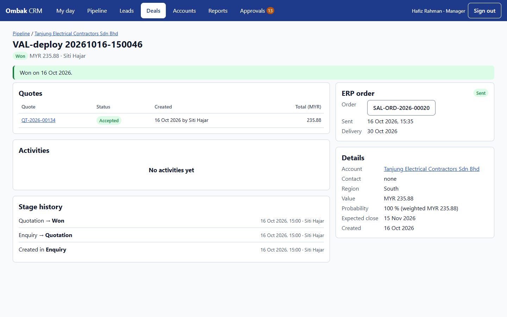 | 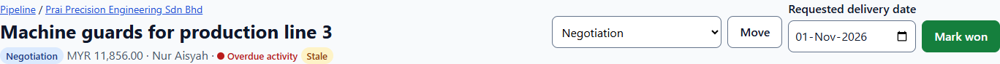 |

The same order in ERPNext Desk: submitted (To Deliver and Bill), net total 235.88 as quoted,
one SST row, created by the CRM Integration user.

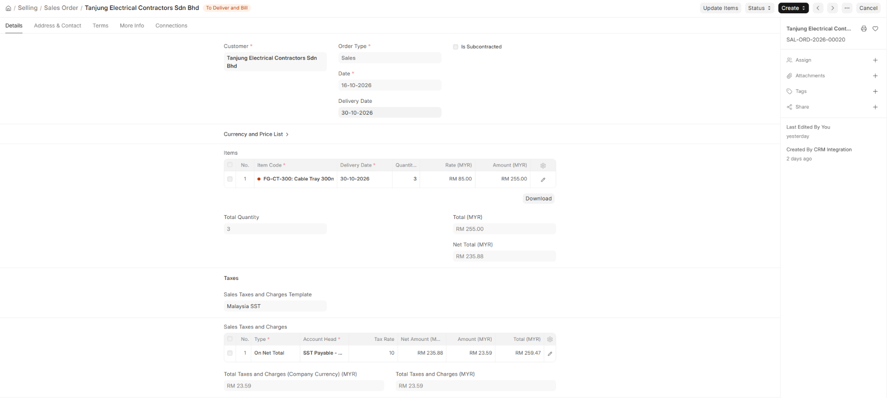

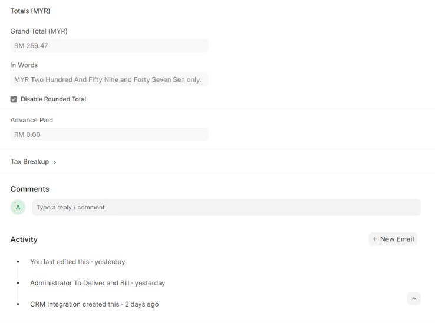

## Demo video click path

1. **Ombak Factory** workspace: the 3 number cards and the report shortcuts.
2. **Sales Order** → open one from early in the month → **Connections**: work order, delivery note, invoice (the production plan is linked from the work order).
3. **Production Plan** for an order of *Pallet Rack Upright 3m*: MRP found no GI 2.0 mm sheet in stock and raised a **material request** → **purchase order** → **purchase receipt** with an **incoming inspection**.
4. **Work Order** → its 4 **job cards**: time logs per operation, all in sequence.
5. **Defect Log** → new → pick a job card → try a qty larger than was produced → the error.
6. **Reports**: On-Time Rate from the demo's first day (find a late order and its rejected inspection), Workstation Load for the week after the demo was generated (Welding Bay is the busiest), Operation Time Variance, Defect Pareto.
7. **Delivery Trip**: driver, lorry, stops.
8. Log in as the production manager → **bell** → overdue alert → filtered list.
9. **Terminal** (http://localhost:8081, `rajesh`): Laser Cutting → **Start** a Ready card → timer → **Pause** → **Resume** → **Complete** with one defect line → the card leaves the queue.
10. Back in ERPNext Desk: that **Job Card** is Completed with Rajesh Kumar's time logs, and the **Defect Log** is there; the next operation's card is now Ready on its station.
11. **CRM** (http://localhost:8082/enquiry/, signed out): send an enquiry from Johor → sign in as `siti`: it's on her My day.
12. Convert it → **Pipeline**: move the new deal with its "Move to" control; moving it to Quotation is refused until a quote is sent.
13. **New quote** with a 15 % line → **Finish the quote** → sign in as `hafiz` → **Approvals** → approve → back as `siti`: **Mark as sent**, then **Mark won**.
14. `hafiz` → **Reports**: the won deal in the win rate and forecast; **My day** shows the team's deals with no next step.
15. With the ERP link on: at step 13, **Mark won** with the suggested delivery date → "Sales order SAL-ORD-… created in ERPNext." → the deal's **ERP order** panel → its link opens the order in Desk: To Deliver and Bill, with the SST row and the quote number in `crm_reference`.

## Design decisions and limits

- **Configure first, code second.** Everything ERPNext already does (MRP, capacity planning, inspections, delivery trips) is configuration; custom code only fills gaps.
- **No transfer to the WIP warehouse.** Work orders consume material straight from the raw-material store at the manufacture entry (`skip_transfer`). This is simpler for a small job shop; the WIP and Rejected warehouses exist but stay empty.
- **Defect logs don't move stock.** They are a quality record. Scrapping or reworking parts would be a separate stock entry.
- **Single company, MYR only**, default chart of accounts, no HR or payroll.
- **Local demo only:** default passwords, no HTTPS. `docker-compose.yml` is adapted from frappe_docker's `pwd.yml`. Two changes make live updates work locally: the site is named `localhost`, and the websocket container shares the backend's network.

## Built with

ERPNext / Frappe v16, MariaDB, Redis, Docker. Python for the app, SQL (via Frappe's query
builder, always with bound parameters) for the reports. Django 6.1, gunicorn and WhiteNoise
for the shop-floor terminal and the sales CRM (on PostgreSQL 17), with plain CSS (design tokens) and a few lines of JavaScript. Built with AI assistance (Claude) using a
spec → tests → build → independent review workflow; the specs and test plans are in `.specship/`.

---

## 中文说明

演示公司 **Ombak Metal Works Sdn Bhd** 是一家**虚构**的柔佛州钣金加工厂（按订单生产）。这个仓库用 **ERPNext v16** 实施它的 ERP，写了一个自定义 Frappe 应用 `ombak_mfg`，补上 ERPNext 原本没有、但生产主管需要的功能；另外用 **Django** 写了一个车间平板报工页，操作员在平板上使用，只通过 REST API 读写 ERPNext。销售团队用的是另一套 **Django 销售 CRM**，成交的商机会变成 ERPNext 的销售订单。

整个项目分三部分：**ERP**（`ERP/`：ERPNext + `ombak_mfg` + Django 平板页）→ **CRM**（Django + PostgreSQL，`CRM/`，见[下文](#销售-crmdjango)）→ **系统串接**（CRM 成交 → ERP 销售订单）。公司、客户、供应商和人名全部是虚构的。

### 展示内容

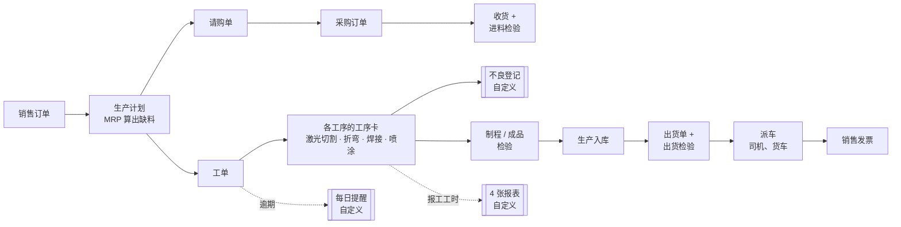

| 范围 | 标准 ERPNext（设定） | `ombak_mfg` 自定义代码 |
|---|---|---|
| 主数据 | 公司、会计年度、仓库（原料、在制、成品、不良品）、10 种原料、5 种成品、带工序路线的 BOM、4 个工作站（人工 + 机器费率）、质检模板、客户、供应商、司机、货车、假日表 | 一个可重复执行的设定脚本，建好以上全部 |
| 流程 | 销售订单 → 生产计划（MRP）→ 请购 → 采购 → 收货 → 工单 → 工序卡 → 生产入库 → 出货 → 派车 → 开票 | 生成一个月真实感数据的脚本，日期以当天为准 |
| 车间 | 工序卡、产能排程 | **不良登记（Defect Log）** + **不良原因（Defect Reason）** 两个 DocType |
| 管理 | | **4 张 Script Report**、**每日逾期提醒**、带 3 张数字卡片的 **Ombak Factory** 工作台 |

### 启动

需要 Docker Desktop（约 8 GB 硬盘，容器需要 4 GB 内存）。

```bash
cd ERP
docker compose up -d --build          # 第一次会构建镜像并建立站点（约 2-5 分钟）
docker compose exec backend bench --site localhost execute ombak_mfg.setup.demo.run         # 约 1 分钟
docker compose exec backend bench --site localhost execute ombak_mfg.setup.check_demo.check # 逐项显示 PASS/FAIL
docker compose exec portal python manage.py seed_operators                                  # 建立 4 个操作员的平板页账号
```

ERPNext 打开 **http://localhost:8080**，平板页打开 **http://localhost:8081**（请用 `localhost`，不要用 `127.0.0.1`：站点按主机名命名，实时更新也只在这个地址有效）。

| 账号（仅限本地演示） | 密码 | 角色 |
|---|---|---|
| `Administrator` | `admin` | 所有权限 |
| `lim.weijie@ombakmetal.example` | `Ombak@2026` | 生产主管（会收到逾期提醒） |
| 平板页：`ahmad`、`meiling`、`rajesh`、`nurul` | `Operator@2026` | 操作员（见下文） |

两个端口都只绑定在 `127.0.0.1`，局域网里的其他电脑连不进来。

- **测试**：`bash ERP/scripts/test.sh`（50 个 ERPNext 集成测试，跑在独立的 `test.localhost` 站点）和 `bash ERP/scripts/test-portal.sh`（63 个 Django 测试，其中包括对独立的 `contract.localhost` ERPNext 站点的合约测试）。都不会动到演示数据。
- **手动测试手册**：[`docs/test-manual.html`](docs/test-manual.html)，中英文可切换（默认英文，用页面顶部的「EN / 中文」按钮切换），下载后用浏览器打开。里面有 45 项逐个网页的测试，涵盖 ERPNext、平板页、CRM 和 CRM → ERPNext 串接；每项写明要打开的网址（点一下就开）、怎么操作、应该看到什么。可以逐项标记通过或失败、给失败项写备注、一键复制测试结果；命令都有复制按钮。标记只存在你自己的浏览器里。
- **重来**：演示数据的日期以生成当天为准。`docker compose down -v`，然后重新执行上面的命令。
- **马上触发提醒**，不用等每日任务：`docker compose exec backend bench --site localhost execute ombak_mfg.tasks.notify_overdue_work_orders`。
- **改了应用代码之后**：`docker compose restart backend`（nginx 和 websocket 会跟着重启）；改了平板页代码之后：`docker compose restart portal`。要在界面里修改 DocType，先执行 `bench --site localhost set-config developer_mode 1`，改动才会写回应用。

### 自定义部分

| 部分 | 位置 | 规则 |
|---|---|---|
| 不良登记（Defect Log） | `ombak_mfg/ombak_mfg/doctype/defect_log/` | 关联一张**已提交**的工序卡；工单、工序、工作站和物料从工序卡带入，不能修改。同一张工序卡上已提交的不良数量不能超过它的完工数量。取消的登记会释放数量。 |
| 工单准时率 | `…/report/work_order_on_time_rate/` | 期间内已完成的工单。**准时** = 在计划完工**日期**当天或之前完成（同一天晚一点完成也算）。显示准时率和平均延迟天数。 |
| 工作站负荷 | `…/report/workstation_load/` | ERPNext 产能排程在所选那一周排给每个工作站的分钟数 ÷ 可用分钟数（每天工作时数 × 6 天）。≥ 90% 标为瓶颈。产能排程不会把工作站排到超过 100%，多出来的工作会顺延到之后几周。 |
| 工时差异 | `…/report/operation_time_variance/` | 每张已完成的工序卡：标准分钟数（BOM 工时 × 数量）对比实际报工分钟数，差异以分钟和百分比显示。 |
| 不良 Pareto | `…/report/defect_pareto/` | 已提交的不良登记按原因汇总，从多到少排列，显示百分比和累计百分比。 |
| 逾期提醒 | `ombak_mfg/tasks.py`（每日） | 每位 Manufacturing Manager 每天一条铃铛通知："Overdue work orders: N"。点开就是筛选好的逾期工单列表。只有铃铛，不发邮件（演示环境没有邮件服务器）。 |
| 演示数据 | `ombak_mfg/setup/masters.py`、`demo.py`、`check_demo.py` | 19 张订单：9 张准时完成，3 张延迟（每张都有一次不合格的制程检验和返工），3 张未完成且已逾期，4 张排在接下来几天。 |

| Ombak Factory 工作台 | 逾期提醒 |
|---|---|
|  |  |

| 生产计划（MRP） | 不良数量超过完工数量时的错误 |
|---|---|
|  |  |

| 工单准时率 | 工作站负荷 |
|---|---|
|  |  |

不良 Pareto：


### 车间平板页（Django）

ERPNext 的工序卡表单是给计划员用的，不适合戴着手套的操作员。平板页（`ERP/portal/`，Django 6.1）就是每个工作站上的页面：选工作站，看到它所有未完成的工序卡，**开始 / 暂停 / 继续 / 完成**，并登记不良。数据只存在 ERPNext 里，Django 只存操作员的登录账号。

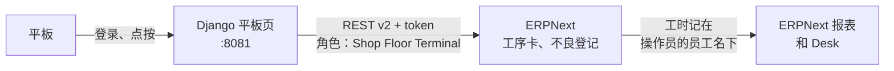

| 操作员（密码 `Operator@2026`） | 默认工作站 |
|---|---|
| `ahmad` | 激光切割（Laser Cutting） |
| `meiling` | 数控折弯（CNC Press Brake） |
| `rajesh` | 焊接区（Welding Bay） |
| `nurul` | 喷涂（Powder Coating） |

任何操作员都可以在任何工作站作业（在页首选择工作站）；每条工时都记在操作员自己的 ERPNext 员工名下，所以 Desk 里看得到是谁做的。

**队列怎么排**
- 显示这个工作站所有未完成的工序卡，每张都有状态（**Running** 进行中、**Paused** 暂停、**Ready** 可开始，或 **Waiting** 等前一道工序）和时间标签（**Overdue**：已过计划完工时间；**Today**：计划在今天结束前开始；**Later**：之后）。
- 排序：进行中、暂停，然后按逾期、今天、之后。每个工作站最多显示 50 张。
- **完成**会一次报完剩余的全部数量；不良品最多可以填三行（原因 + 数量）。暂停中的工序卡会在同一刻继续并完成，因为 ERPNext 不让暂停中的工序卡提交（所以 Desk 里会留下一条 0 分钟的工时）。

**值得一问的设计决定**
- **时间用吉隆坡当地时间发送。** ERPNext 存的是不带时区的本地时间；发 UTC 会让每条工时差 8 小时（合约测试抓到后修正）。
- **直接用 ERPNext 自己的工序卡方法**（`start_timer`、`pause_job`、`resume_job`、`complete_job_card`），所以 ERPNext 原有的工序顺序和工时重叠检查都还在。平板页再补上 ERPNext 没做的检查：进行中或暂停中的工序卡不能再开始，只有暂停中才能继续，没开始不能完成。
- **最小权限：** API 用户只有一个角色 *Shop Floor Terminal*：工序卡读/写/提交，工作站和员工只读，不良登记新建/提交，不良原因只读，工单读/写/提交（完成工序卡时要更新已提交的工单，Frappe 检查的是*提交*权限）。它不能新建或取消工单，也读不了销售、会计、BOM 和库存（测试逐项验证）。
- **默认安全：** 每个操作都是带 CSRF 的 POST；工序卡名称必须是 `PO-JOB` 加 ASCII 数字，才会调用 ERPNext；ERPNext 错误信息里的 HTML 会被去掉；严格的内容安全策略（CSP，任何地方都没有内联脚本或样式）；按钮 64 px，戴手套也能按；Lighthouse 手机模式 100/100/100。
- **错误讲清楚发生了什么：** ERPNext 拒绝时显示 ERPNext 给出的原因；保存途中连接中断时，提示先到 ERPNext 确认，再决定是否重试。

**代码结构**（`ERP/portal/terminal/`）

| 模块 | 作用 |
|---|---|
| `erpnext.py` | 唯一发 HTTP 请求的代码：REST v2 客户端、错误对应 |
| `queue.py` | 纯逻辑：状态、时间标签、排序、已用时间 |
| `views.py` | 队列、开始/暂停/继续、完成（+ 不良行） |
| `forms.py` | 完成表单里的不良行 |
| `models.py` | `Operator`：Django 用户 ↔ ERPNext 员工 + 默认工作站 |
| `management/commands/seed_operators.py` | 演示账号，按员工姓名关联 |
| `templates/`、`static/` | 一个使用设计变量（token）的样式表、一小段脚本（计时、按钮忙碌状态、自动刷新） |
| `tests/` | 使用假 ERPNext 的单元测试、对真实 ERPNext 的合约测试（`api-contract.md` 在 `.specship/`） |

设定来自环境变量，带本地演示默认值（`ERP/docker-compose.yml`）：`PORTAL_SECRET_KEY`、`SHOPFLOOR_API_KEY`、`SHOPFLOOR_API_SECRET`、`OPERATOR_PASSWORD`。只要不是在笔记本上演示，就请在 `ERP/.env` 里填上真实的值。

**限制：** 只能报全部数量（不能部分完成）；不良只能在完成时登记；没有扫码、离线模式和 PIN 快速切换操作员；开发用的目录挂载以自动刷新方式提供静态文件。

| 平板 | 手机 |
|---|---|
|  |  |


### 销售 CRM（Django）

销售团队自己的系统（`CRM/`，Django 6.1 + PostgreSQL 17），和 ERP 是两个独立的应用。网站询价变成线索，分给客户所在地区的业务员。线索转成商机，按工厂的阶段推进。报价来自价目表，大折扣需要销售经理批准。每个商机最后不是成交，就是丢单并注明原因。产品编号和价格就是 ERPNext 的物料，成交的商机会变成 ERPNext 销售订单（见[第三部分](#crm--erpnext-销售订单第三部分)）。

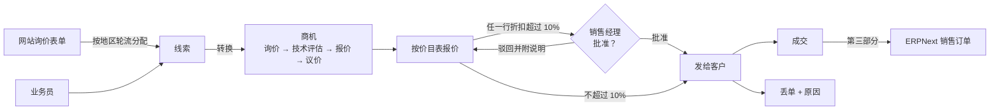

```bash
cd CRM
docker compose up -d --build                       # PostgreSQL + Django，打开 http://localhost:8082
docker compose exec web python manage.py seed_demo  # 团队、产品、16 个客户、5 个季度约 50 个商机
bash scripts/test.sh                                # 在 PostgreSQL 上跑 331 个测试（17 个连 ERPNext 的测试在这里跳过）
```

| 账号（仅限本地演示，密码 `Sales@2026`） | 角色 | 地区 |
|---|---|---|
| `hafiz` | 销售经理：看得到全部、批准折扣、改派商机、使用 `/admin/` | |
| `aisyah` | 业务员 | 北区（玻璃市、吉打、槟城、霹雳、吉兰丹、登嘉楼） |
| `kumar`、`jason` | 业务员 | 中区（雪兰莪、吉隆坡、布城、森美兰、彭亨、东马） |
| `siti` | 业务员 | 南区（柔佛、马六甲） |
| `weiling` | 业务员 | 新加坡 |

公开询价表单在 **http://localhost:8082/enquiry/**，不用登录。

**系统执行的规则**
- **线索分配：** 业务员自己录入的线索归自己。网站询价会分给该地区里未跟进线索最少的在职业务员（中区有两个业务员，所以会轮流分到）。该地区没有在职业务员时，线索不分配，出现在经理的「我的一天」上。
- **阶段：** 询价 10%、技术评估 / 打样 25%、报价 50%、议价 75%。没有发出报价，商机不能进入报价或议价阶段，也不能成交；丢单必须从后台可编辑的原因列表里选一个。每次移动都记在商机的历史里（谁、什么时候）。
- **报价：** 单价就是价目表价格，不能手改，唯一能调的是每行折扣。任何一行超过 10%，报价单就要交给经理批准，或附说明驳回。
  - 经理批准的就是屏幕上看到的那些行。如果打开页面之后报价单被改过，批准会被拒绝，并提示 "This quote changed since you opened it"。
  - 只有已批准的报价单可以打印或发出，已批准或已发出的报价单会锁定。
  - "Revise" 会建一张新草稿，旧报价单在修订版发出之前仍然是已发出状态。
- **编辑：**
  - 负责人或经理可以修改未结案的商机（标题、联系人、预计成交日期、金额）。报价发出后金额锁定，因为金额由报价决定。
  - 未结案的线索可以修改。改了州属，线索会移到新地区，但负责人不变。
  - 客户和联系人是共享的，任何人都可以修改。
  - 已成交、已丢单、已转换、已取消资格的记录都是只读的。
  - 经理可以把商机改派给另一个业务员，未完成的活动会一起转过去。
- **业务员只看得到自己的**线索、商机、报价和活动。访问别人的记录返回 404 而不是 403，所以不会泄露编号。客户是共享的。
- **报表**（任一季度）：
  - 按阶段的未结管道（金额和加权金额）；
  - 每个业务员的成交率（成交 ÷（成交 + 丢单），按件数）；
  - 预测（本季度已成交 + 本季度预计成交的加权管道，另附最佳情况）；
  - 丢单原因。
- **我的一天：**
  - 每个人都看得到自己逾期和今天的活动、没有下一步的商机、14 天没动的商机，以及新线索。
  - 经理的商机面板涵盖整个团队，并标出每个负责人。经理还会看到待审批的报价和未分配的线索。
  - "今天"按吉隆坡日期计算，UTC 还是前一天的早上 7 点也一样。

**值得一问的设计决定**
- **规则集中在一个地方。** `rules.py` 用普通函数实现金额、折扣和阶段规则。
  - 模型上的流程方法（`Quote.submit/approve/send/revise`、`Opportunity.move_to/mark_won/mark_lost/edit/reassign`、`Lead.convert/edit`）会加行锁，并在锁内重新检查状态。重复点击不会把线索转换两次，也不会把商机成交两次；提交时新增的一行也逃不过审批。
  - 数据库用检查约束兜底：折扣 0-100、数量大于 0、一条活动只属于一个上级记录。
- **金额用 `Decimal`**，每行先四舍五入到 2 位小数再加总（85.00 × 3 减 7.5% = 235.88）。
- **报表的查询次数固定**（整页不超过 15 次聚合查询），不随商机数量增加，有测试专门计算查询次数。
- **看板不靠 JS 框架：** 每张卡片都有一个 "Move to" 下拉框，用键盘或在没有 JavaScript 时都能操作。拖放只是提交同一个表单，所以两种方式都走同一套服务器规则。
- **默认安全：**
  - 每个 POST 都有 CSRF，并启用严格的 CSP（没有内联脚本或样式）。
  - 同一个用户名 15 分钟内输错 10 次密码就会被锁。`/login/` 和 `/admin/login/` 都适用，数据库行锁能准确计算同时进来的尝试。
  - 经理可以在 `/admin/` 管理业务员，但不能给任何人管理员权限。
  - 询价表单有蜜罐字段（honeypot）和频率限制。
  - CSV 导出会让电子表格公式失效，因为公开表单里输入的名字会出现在导出文件里。
- **无障碍：**
  - 控件高度 44 px，焦点清晰可见。
  - 表单错误显示在字段旁边，焦点会跳到第一个出错的字段。
  - 看板控件都有标签，报表里的条形图是服务器端渲染的 SVG。
  - 我的一天、看板和报价页的 Lighthouse 都是 100/100/100。

**代码结构**（`CRM/sales/`）

| 模块 | 作用 |
|---|---|
| `models.py` | 数据模型 + 流程方法（加行锁） |
| `rules.py` | 纯规则：金额、审批门槛、阶段关卡、下一步活动标示、成交率 |
| `regions.py` | 州属 → 地区对照表、轮流挑选负责人 |
| `access.py` | 谁能看到什么（每个视图都通过它取记录） |
| `ratelimit.py` | 登录锁定和询价频率限制用的固定窗口计数器 |
| `admin.py` | 产品、丢单原因、业务员；防止提权的用户管理 |
| `reports.py` | 四张报表的聚合查询 |
| `erpnext.py`、`erp.py` | ERPNext 串接（第三部分）：REST 客户端；字段对应和发送流程 |
| `views/` | 我的一天、登录、线索、询价、客户、活动、商机和看板、报价、报表 |
| `management/commands/seed_demo.py` | 可重复执行、日期以当天为准的演示数据 |
| `tests/` | 331 个测试，覆盖 `.specship/completed/` 下 003 和 004 测试计划的每个案例 |

设定来自环境变量，带本地演示默认值（`CRM/docker-compose.yml`）：`CRM_SECRET_KEY`、`CRM_DB_PASSWORD`、`CRM_DEMO_PASSWORD`。`CRM/scripts/ui-probe/` 会检查三种屏幕尺寸、表单出错后的焦点，以及 Lighthouse。

**被锁住了？** 输错 10 次密码会把这个用户名锁 15 分钟，系统里没有解锁按钮。解除某个用户的锁定：
`docker compose exec web python manage.py shell -c "from sales import ratelimit; ratelimit.clear('login', 'hafiz')"`。

**限制：**
- 只用马币，报价不含 SST（马来西亚客户的 ERPNext 订单会加上，见第三部分）。
- 只有一级审批。
- 没有邮件和日历同步，没有附件，也没有自定义字段。
- 结案的商机不能重新打开。
- 商机的修改和改派不会记在商机历史里。
- 报价被批准或驳回时，业务员不会收到通知；过期的报价也没有标记。
- 询价频率限制按客户端地址计算，本地运行时每个访客都是 Docker 网关的地址，所以任何人提交 5 次询价后，表单会关闭一小时。

| 我的一天（经理） | 销售管道 |
|---|---|
|  |  |

| 等待批准的报价 | 报表 |
|---|---|
|  |  |

| 编辑商机 | 手机上的我的一天 |
|---|---|
|  |  |

### CRM → ERPNext 销售订单（第三部分）

业务员把商机标为**成交**时，CRM 会在同一个请求里，在 ERPNext 建一张**已提交的销售订单**，生产主管马上就能排产。两套系统仍然分开：CRM 只通过 ERPNext 的 REST API 写入，和平板页一样。

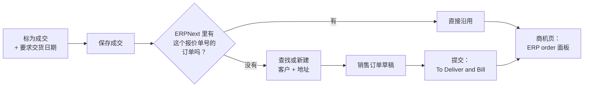

```bash
cd ERP && docker compose up -d          # 先启动 ERP，它会建立 erp_crm_link 网络
cd ../CRM
docker compose -f docker-compose.yml -f docker-compose.erp.yml up -d --build
bash scripts/test-erp.sh                # 17 个合约测试，跑在独立的 contract.localhost 站点
```

不加 `docker-compose.erp.yml` 时，CRM 和第二部分一样单独运行，成交的商机会显示 "ERP link not configured"。第三部分之前建立的 ERP 站点，要先补一次对接用户和密钥：`docker compose exec backend bench --site localhost set-config crm_api_key crm-demo-key`，`crm_api_secret` 同理（默认 `crm-demo-secret`），然后执行 `docker compose exec backend bench --site localhost execute ombak_mfg.setup.masters.setup_masters`。

**成交时会发生什么**
- **成交不会丢：** 先保存成交，再发订单（10 秒超时）。ERPNext 连不上或拒绝时，商机仍然是成交，**ERP order** 面板会显示原因和 **Send again** 表单。以前成交的商机也可以从同一个面板补发。
- **不会重复建单：** 报价单号写进订单的 `crm_reference` 字段，这个字段在 ERPNext 里是唯一的。每次发送都先按单号查找，已经存在就直接沿用。发送前会先有条件地把商机标为「发送中」，所以连点两次也只会发一次。
- **客户：** 按名称精确查找，找不到就新建（公司类型、Commercial 客户组、按客户的州属归到马来西亚或新加坡地区、SSM/UEN 号码作税号）。客户资料有地址和城市时，会一并建账单地址。
- **金额一分不差：** 明细按报价的价目表价格，报价的折扣合成一笔整单折扣，并关闭整数取整，所以订单净额和报价总额完全相同。万一 ERPNext 算出的金额还是不一样，面板会显示 "Sent, total differs"。
- **SST：** 马来西亚客户的订单套用模板「Malaysia SST - OMW」（10%，这是一个假设：部分钢材产品按税则号是 5%；税率只存在这个模板里）。新加坡客户的订单不加税（假设按 K2 出口）。
- **交货日期：** 成交时必填，默认今天 + 14 天（吉隆坡时间），范围是今天到 365 天内。
- **谁能发送：** 商机负责人或经理。发送失败的商机会列在「我的一天」的 "ERP orders not created" 下（经理看到整个团队的）。
- **最小权限：** ERPNext 里的「CRM Integration」角色可以新建销售订单，但只能读取、修改、提交自己建的订单（`if_owner`）。它还可以读取和新建客户、新建和读取地址、读取物料和税务模板。它不能取消或删除订单，也碰不到发票、工单和工序卡（测试逐项验证）。CRM 容器只和 ERPNext backend 共用一个网络，连不到 Redis 和 MariaDB。

设定（`CRM/docker-compose.erp.yml`）：两边共用 `CRM_API_KEY` / `CRM_API_SECRET` 这两个变量；默认的 `crm-demo-key` / `crm-demo-secret` 只适合在笔记本上演示，其他场合请在 `ERP/.env` 和 `CRM/.env` 里改掉。`ERPNEXT_SITE`（默认 `localhost`）；`ERPNEXT_DESK_URL`（面板上订单链接的地址，默认 http://localhost:8080）。代码：`CRM/sales/erpnext.py`（REST 客户端）、`CRM/sales/erp.py`（字段对应和发送流程），ERP 这边是 `ombak_mfg/setup/masters.py`（角色、用户、`crm_reference`、SST）。

**已知问题和限制**
- ERPNext 的 `/printview` 页面不检查 `if_owner`，所以对接密钥可以读到任何销售订单。只能读，不能改。中等风险，已接受。
- 在 ERPNext 里修订（Amend）已取消的订单会复制 `crm_reference`，因此会被当成重复而拒绝。修改 ERP 订单不在范围内。
- 产品以整数件（Nos）计：报价里有小数数量的行会发送失败，商机上会显示 ERPNext 给出的原因。
- ERP backend 容器被重建（不只是重启）时，websocket 也要重建：`docker compose up -d --force-recreate websocket`，因为它和 backend 共用网络。
- 同一个新客户的两个不同商机如果在同一瞬间发送，可能在 ERPNext 建出两个客户。
- 查找时找到的草稿订单，会按它原来的日期提交。
- 另一次发送还在进行时，用无效日期重发会得到日期错误（400），而不是"正在发送"。
- 不会同步回来：在 ERPNext 取消或修改订单，CRM 里看不到。没有自动重试。
- 报价单号来自 CRM 数据库，CRM 重新灌数据后，ERPNext 里同号的旧订单会被沿用。

| 成交商机上的 ERP order 面板 | 成交时填写交货日期 |
|---|---|
|  |  |

同一张订单在 ERPNext Desk 里：已提交（To Deliver and Bill），净额 235.88 与报价一致，一行 SST，由 CRM Integration 用户建立。


### 演示视频操作路线

1. **Ombak Factory** 工作台：3 张数字卡片和报表快捷方式。
2. **Sales Order** → 打开一张月初的订单 → **Connections**：工单、出货单、发票（生产计划从工单打开）。
3. 一张 *Pallet Rack Upright 3m* 订单的 **Production Plan**：MRP 发现 GI 2.0 mm 钢板没有库存，自动建了**请购单** → **采购订单** → 带**进料检验**的**采购收货**。
4. **Work Order** → 它的 4 张**工序卡**：每道工序的工时记录，按顺序完成。
5. **Defect Log** → 新建 → 选一张工序卡 → 输入比已生产数量还多的数量 → 出现错误提示。
6. **报表**：准时率（From Date 设为演示数据的第一天，找一张延迟的订单和它不合格的检验）、演示数据生成后那一周的工作站负荷（焊接区最忙）、工时差异、不良 Pareto。
7. **Delivery Trip**：司机、货车、停靠点。
8. 用生产主管的账号登录 → **铃铛** → 逾期提醒 → 筛选好的工单列表。
9. **平板页**（http://localhost:8081，`rajesh`）：激光切割 → 对一张 Ready 的工序卡按 **Start** → 计时 → **Pause** → **Resume** → 填一行不良后 **Complete** → 这张工序卡离开队列。
10. 回到 ERPNext Desk：这张**工序卡**已完成，带有 Rajesh Kumar 的工时记录，**不良登记**也在；下一道工序的工序卡在它的工作站上变成 Ready。
11. **CRM**（http://localhost:8082/enquiry/，不登录）：从柔佛提交一个询价 → 用 `siti` 登录：询价出现在她的「我的一天」上。
12. 转换成商机 → **Pipeline**：用 "Move to" 移动这个新商机；在发出报价之前，移到 Quotation 会被拒绝。
13. **New quote**，其中一行折扣 15% → **Finish the quote** → 用 `hafiz` 登录 → **Approvals** → 批准 → 回到 `siti`：**Mark as sent**，然后 **Mark won**。
14. `hafiz` → **Reports**：成交的商机出现在成交率和预测里；**My day** 显示团队里没有下一步的商机。
15. 开着 ERP 串接时：第 13 步用建议的交货日期 **Mark won** → "Sales order SAL-ORD-… created in ERPNext." → 商机的 **ERP order** 面板 → 点链接在 Desk 打开订单：To Deliver and Bill，带 SST 那一行，`crm_reference` 是报价单号。

### 设计取舍与限制

- **先用设定，再写代码。** ERPNext 已有的功能（MRP、产能排程、质检、派车）都用设定完成，自定义代码只补空缺。
- **不转到在制仓。** 工单在生产入库时直接从原料仓扣料（`skip_transfer`）。对小型加工厂来说更简单；在制仓和不良品仓存在，但一直是空的。
- **不良登记不动库存。** 它是质量记录；报废或返工零件要另做库存凭证。
- **单一公司、只用马币**，默认会计科目表，没有人事和薪资。
- **仅供本地演示：** 默认密码，没有 HTTPS。`docker-compose.yml` 改自 frappe_docker 的 `pwd.yml`，有两处修改让实时更新在本地可用：站点名叫 `localhost`，websocket 容器和 backend 共用网络。

### 技术栈

ERPNext / Frappe v16、MariaDB、Redis、Docker。应用用 Python，报表用 SQL（通过 Frappe 的查询构造器，一律使用绑定参数）。平板页和销售 CRM 用 Django 6.1、gunicorn 和 WhiteNoise（CRM 用 PostgreSQL 17），样式是纯 CSS（设计变量），只有少量 JavaScript。这个项目是在 AI（Claude）辅助下完成的，流程是：需求规格 → 先写测试 → 实现 → 独立审查；规格和测试计划放在 `.specship/`。
